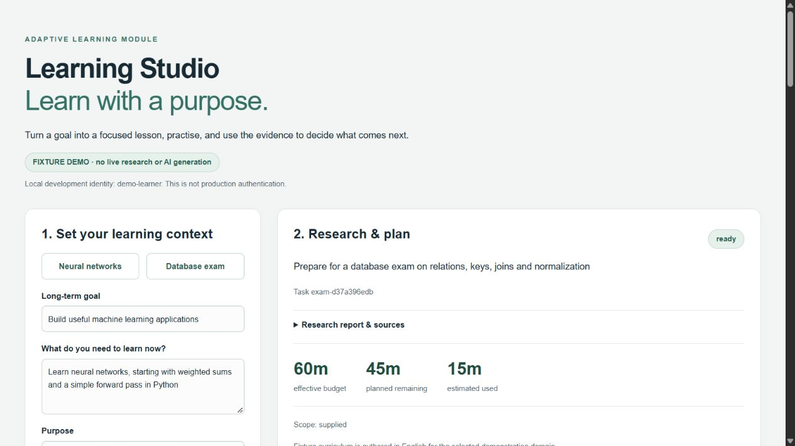
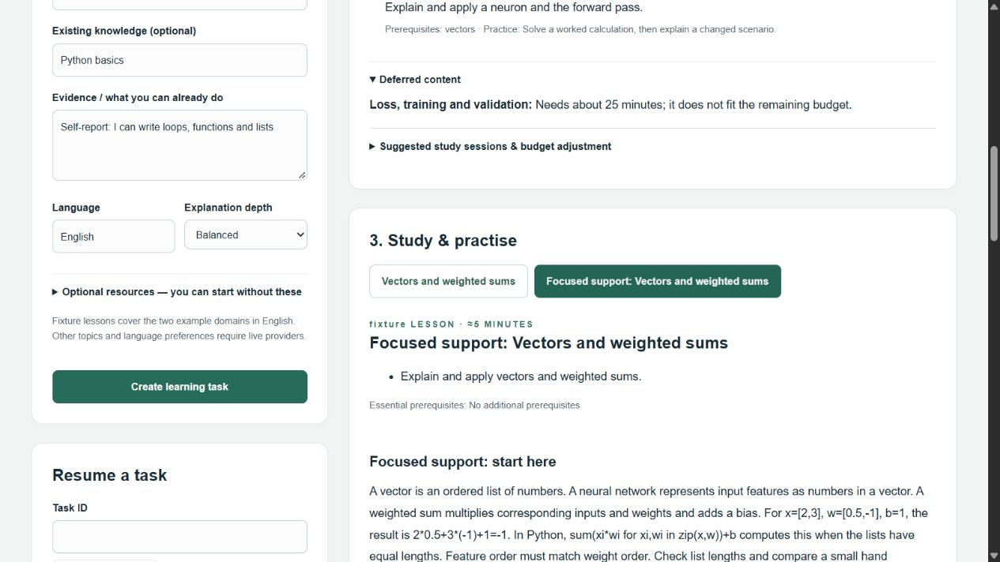

# LearningStudio — Adaptive AI Learning & Exam Prep Platform

[](LICENSE)
[](https://www.python.org/)
[](https://fastapi.tiangolo.com)
[](https://nextjs.org/)
[](https://www.postgresql.org/)

Turn any subject or exam into a focused, evidence-backed curriculum. LearningStudio researches authoritative web sources or syllabus materials, budgets your study time, teaches with verified passage citations, conducts semantic accuracy audits, and dynamically adapts lessons based on your quiz performance. **No document upload is required.**

Supports both offline credential-free **Fixture Mode** for instant local demonstrations and **Live Mode** powered by Tavily web research and Google Gemini.

<p align="center">
  
  
</p>

## Getting Started

### Option 1: Run with Docker (Recommended)

Running with Docker is the primary and recommended method for both development and production. It boots a complete, isolated stack:
* **PostgreSQL 17** database with persistent data volume
* **Alembic** schema migrations applied automatically
* **FastAPI** backend API with reload
* **Background SQL Worker** for long-running research and lesson generation
* **Next.js 14** frontend with instant Webpack hot-module reloading

> **Note on Environment Variables:** When running with Docker, all networking and URLs (such as `BACKEND_URL=http://api:8000`) are injected directly by Docker Compose into the containers. **No `frontend/.env.local` is needed.**

Prerequisites: [Docker Desktop](https://www.docker.com/) (with Docker Compose).

```sh
# 1. Create your environment configuration from the template
cp .env.example .env

# 2. Start the full development stack with live reload
make dev
# or: docker compose -f compose.yaml -f compose.dev.yaml up

# To rebuild after dependency changes:
make dev-build

# To stop all services:
make stop
```

Open [Learning Studio](http://localhost:3000) and [FastAPI Swagger Docs](http://localhost:8000/docs).
PostgreSQL data persists in the `learning_data` volume across restarts.

#### Enabling Live AI Mode (Tavily + Gemini)

The application starts in zero-credential **Fixture Mode** by default. To enable real-time web research and Gemini generation, edit the root `.env` file:

```dotenv
PROVIDER_MODE=live
TAVILY_API_KEY=your-tavily-key
GEMINI_API_KEY=your-gemini-api-key
GEMINI_MODEL=gemini-2.5-flash-lite
```

Get an API key from [Google AI Studio](https://aistudio.google.com/apikey) and [Tavily](https://tavily.com/). After editing `.env`, run `make dev`.

---

### Option 2: Run locally without Docker (Alternative)

If you prefer to run services natively on your host machine:

Prerequisites: Python 3.12+ and Node 20.9+ (Node 24 verified).
SQLite is supported for local single-worker demos.

**1. Backend & Worker:**
```sh
python -m venv .venv
# Windows: .venv\Scripts\activate
# macOS/Linux: source .venv/bin/activate
python -m pip install -r backend/requirements.lock.txt
cd backend
alembic upgrade head
uvicorn app.main:app --host 127.0.0.1 --port 8000
```

In another activated terminal:

```sh
cd backend
python -m app.worker
```

In another terminal:

```sh
cd frontend
npm ci
npm run dev
```

With no `.env`, the backend uses fixture mode and `backend/learning.db`. For local overrides,
copy `.env.example` to **backend/.env** and change `DATABASE_URL` to `sqlite:///./learning.db`
or an accessible PostgreSQL URL. For frontend overrides copy `frontend/.env.example` to
`frontend/.env.local`. The web proxy must use the same `DEV_API_TOKEN` as the backend.
Run API and worker from the same backend directory so they share settings and database.

The frontend uses webpack and includes a WebAssembly SWC fallback for Windows environments
whose Application Control policy prevents loading the native compiler. Linux containers can use native SWC.

## Demonstrate both flows

**No documents:** choose Neural networks in the UI and create the task. The worker acquires
three explicitly labelled fixture sources, creates a 60-minute plan, and publishes the first
cited lesson. Open a Source link to inspect the exact stored passage. Answer a choice and a
short-text question, inspect feedback, and create the next lesson. A wrong choice recommends
focused support; the plan reserves five minutes and defers later work as necessary.

**Exam with materials:** choose Database exam. In Optional resources, upload
`examples/syllabus.txt` with role **Syllabus**, then upload `examples/lecture-1-keys.pdf` and
`examples/lecture-2-joins.pdf` with role **Lecture**. The PDFs are small authored fixtures,
not a real university course. Their text is extracted with page references. Supplementary
fixture passages fill out the demo. Exam practice is labelled as generated; no exam weights
or question predictions are claimed. Without a readable syllabus, exam scope stays provisional.

You can also run the HTTP smoke demonstrations against the running API and separate worker:

```sh
python examples/make_pdfs.py  # regenerate the included sample PDFs if desired
python scripts/demo.py
python scripts/demo.py --exam
```

Both scripts print task IDs you can paste into **Resume a task**. They check plan budgets,
resolve a citation, submit a fixture objective answer, and display the updated state.
In live mode they generate lessons but leave answering to the learner; they do not assume
that model-generated questions have fixture answers.

## Test and build

```sh
cd backend
python -m pytest -q
alembic check
cd ../frontend
npm run typecheck
npm run build
```

Tests use isolated SQLite databases and controlled external-service responses. They cover
no-document research, supplied materials and supplementation, context-driven modes, uncertain
exam scope, budgets, citations, assessment/adaptation, identity boundaries, unsafe access,
provider request contracts and failures, idempotency, and lease recovery. Test fixtures are
not evidence that paid integrations worked live. See [verification](docs/VERIFICATION.md).

## Architecture

`backend/app/contracts.py` defines validated public and provider contracts.
`main.py` exposes the API and enforces task ownership. `worker.py` claims persistent jobs;
`research.py`, `safety.py` and `extraction.py` obtain bounded, authorized evidence. `learning.py`
owns curriculum, budgeting, citation checks, grading and adaptation. `providers.py` contains
the live interfaces/adapters; `fixtures.py` contains only authored demonstrations.
`db.py` defines SQLAlchemy persistence, with checked-in Alembic migrations under `migrations/`.

The worker starts by ingesting supplied references, if any, and generating a small candidate
curriculum. It searches for uncovered topics, stores fetched passages, plans within the budget,
and generates only the first lesson. Later lessons are generated on demand through the same
job mechanism. Sources, passages, plans, lessons, states and attempts survive process restarts.

Jobs have a persisted status, lease token, heartbeat and bounded crash-recovery attempts.
PostgreSQL workers claim with `FOR UPDATE SKIP LOCKED`; writes check the current lease token.
Polling requests return promptly. Semantic support auditing is a separate model call; its
uncertainty is visible. Unsupported output is withheld; uncertain output carries a warning.

[Integration contract and API examples](docs/INTEGRATION.md) describe the coordinating boundary.
[Implementation plan](IMPLEMENTATION.md) records the repository inspection and increment sequence.

## Limits and deliberate boundaries

- Development identity only: API callers provide `X-Dev-Token` and `X-Learner-ID`. The web proxy
  fixes the learner to `demo-learner`. Anyone holding the shared token can choose an identity;
  replace this with trusted authentication before any multi-user deployment. Object access is
  scoped to the resulting identity, but the development header is not proof of identity.
- Fixture curricula cover neural networks and databases in English. They are authored demos,
  not general AI lessons. Fixture free-text grading uses a labelled low-confidence keyword
  check, never establishes mastery, and does not perform semantic or contradiction auditing.
  Supplied materials are extracted in fixture mode, but authored lessons use their authored
  fixture evidence. Use live mode for general scope/language/depth adaptation.
- PDF extraction supports text, not OCR, encrypted documents, complex mathematical layout,
  or image interpretation. Scanned/unsupported pages are reported. Size, page and text limits
  apply; PDF parsing is in the worker process, not a hardened hostile-file sandbox.
- Coverage and relevance use lexical heuristics. A keyword hit does not prove adequate
  teaching coverage. The model audit is fallible and not independent human fact-checking;
  valid citation IDs prove only referential integrity. Conflicts are returned with passages.
- Topic reuse currently matches normalized titles exactly. Synonymous topic names may produce
  separate learner states. External prior knowledge is a recorded claim, not trusted mastery.
- Time is estimated, not measured. Attempting a lesson reserves its estimated duration as
  spent. Deadlines cap the budget; no schedules or calendar events are created.
- Default bounds: 3 searches, 6 candidate pages, 5 MB per resource, 80 PDF pages, 20-second
  request timeout, 2 retries, 4 redirects, 6 curriculum topics, 18 passages per lesson, and
  one standard plus one focused-support lesson per topic/task. Repeated support reuses that
  lesson; it does not generate an unlimited tutoring conversation.
- Robots restrictions are honored; authentication, paywalls, compressed responses and blocked
  resources are not bypassed. Redirects are checked and connections pin validated public IPs
  with hostname-verified TLS. Local files are disabled unless a directory is explicitly allowed.
- In-process rate limits protect this local prototype; distributed quotas, real authentication,
  PDF process isolation, data retention/deletion, and operational monitoring remain deployment
  hardening work. No surveillance, activity tracking, arbitrary filesystem discovery, or
  larger goal/scheduling system is included.

## Official API references used

- [Gemini API generateContent](https://ai.google.dev/api/generate-content)
- [Gemini API JSON mode](https://ai.google.dev/gemini-api/docs/json-mode)
- [Tavily Search API](https://docs.tavily.com/documentation/api-reference/endpoint/search)
- [FastAPI uploaded files](https://fastapi.tiangolo.com/tutorial/request-files/)
- [SQLAlchemy ORM](https://docs.sqlalchemy.org/en/20/orm/queryguide/dml.html)
- [Next.js CLI](https://nextjs.org/docs/app/api-reference/cli/next)
